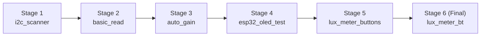
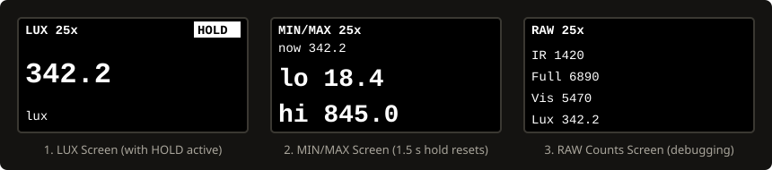
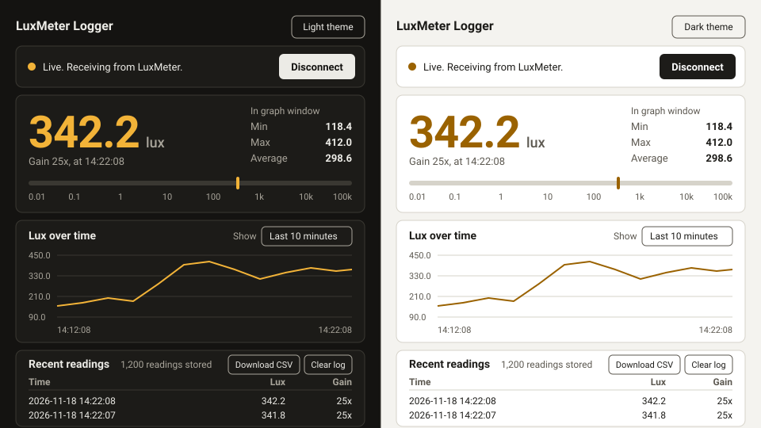

# DIY ESP32 Lux Meter: Complete Build, Setup & Code Guide

This guide walks you through building, testing, calibrating, and understanding the DIY ESP32 Lux Meter from bare parts to live Bluetooth data logging. If you are new to Arduino or ESP32, follow the stages in order so you can verify each piece of hardware before moving to the next.

---

## Table of Contents

1. [Project Structure](#1-project-structure)
2. [Parts & Hardware Wiring](#2-parts--hardware-wiring)
3. [Arduino IDE Installation & Setup](#3-arduino-ide-installation--setup)
4. [Staged Hardware Bring-Up Workflow](#4-staged-hardware-bring-up-workflow)
5. [Configuration & Calibration](#5-configuration--calibration)
6. [Using the Handheld Meter & Web Logger](#6-using-the-handheld-meter--web-logger)
7. [How the Code Works (Key Components)](#7-how-the-code-works-key-components)
8. [Troubleshooting Guide](#8-troubleshooting-guide)

---

## 1. Project Structure

Arduino IDE requires every `.ino` sketch to live inside a folder with the **exact same name**. Rather than splitting one program across multiple files, the [`esp32_lux_meter/`](esp32_lux_meter/) directory provides **6 progressive standalone stages**:



| Path | Purpose |
| --- | --- |
| [`esp32_lux_meter/i2c_scanner/i2c_scanner.ino`](esp32_lux_meter/i2c_scanner/i2c_scanner.ino) | **Stage 1:** Scans the I2C wires to confirm the ESP32 detects the sensor (`0x29`) and OLED (`0x3C`). |
| [`esp32_lux_meter/basic_read/basic_read.ino`](esp32_lux_meter/basic_read/basic_read.ino) | **Stage 2:** Reads infrared + full-spectrum light at fixed `25x` gain and prints lux to Serial. |
| [`esp32_lux_meter/auto_gain/auto_gain.ino`](esp32_lux_meter/auto_gain/auto_gain.ino) | **Stage 3:** Adds automatic sensitivity switching (`1x`, `25x`, `428x`, `9876x`). |
| [`esp32_lux_meter/esp32_oled_test/esp32_oled_test.ino`](esp32_lux_meter/esp32_oled_test/esp32_oled_test.ino) | **Stage 4:** Tests the SSD1306 OLED screen and onboard LED by themselves (useful when testing battery power). |
| [`esp32_lux_meter/lux_meter_buttons/lux_meter_buttons.ino`](esp32_lux_meter/lux_meter_buttons/lux_meter_buttons.ino) | **Stage 5:** Combines the sensor, auto-gain, OLED display, and **HOLD** / **MODE** buttons without Bluetooth. |
| [`esp32_lux_meter/lux_meter_bt/lux_meter_bt.ino`](esp32_lux_meter/lux_meter_bt/lux_meter_bt.ino) | **Stage 6 (Final Firmware):** Complete meter with OLED, buttons, and Classic Bluetooth CSV output. |
| [`lux_logger/index.html`](lux_logger/index.html) | Single-file web application for Windows and Android that graphs and logs Bluetooth readings and exports CSV files. |
| `3d_files/` | 3D-printable enclosure parts (`MAIN BODY.stl`, `COVER.stl`, and `lux_meter_basemodel.3mf`). |
| `DIY ESP32 Lux Meter (TSL2591) Build Documentation.docx` | Complete physical assembly and LiPo battery / TP4056 / boost converter wiring reference. |
| `DIY_ESP32_Lux_Meter_Parts_List.xlsx` | Spreadsheet of all required electronic and mechanical parts. |

---

## 2. Parts & Hardware Wiring

### Required Components
- **Microcontroller:** Classic ESP32 development board (e.g. **ESP32 DevKit V1**). Do not use ESP32-S3 or ESP32-C3, because those chips do not support Classic Bluetooth SPP.
- **Light Sensor:** Adafruit TSL2591 breakout board (`I2C`, address `0x29`).
- **Display:** 0.96" SSD1306 128x64 I2C OLED module (usually address `0x3C`).
- **Buttons:** Two 4-pin tactile push buttons (`HOLD` and `MODE`).
- **Optional Battery Pack:** 3.7V LiPo cell, TP4056 charger module, 5V boost converter, and slide switch (see the `.docx` build document for battery wiring precautions).

### Pin Connections

Both the TSL2591 sensor and the SSD1306 OLED use the I2C bus, which means they share `GPIO 21` (`SDA`) and `GPIO 22` (`SCL`):

| Component | Pin | Connects to ESP32 | Why |
| --- | --- | --- | --- |
| **TSL2591** | `VIN` | `3V3` | Regulated 3.3V power |
| **TSL2591** | `GND` | `GND` | Common ground |
| **TSL2591** | `SDA` | `GPIO 21` | Shared I2C data line |
| **TSL2591** | `SCL` | `GPIO 22` | Shared I2C clock line |
| **SSD1306 OLED** | `VCC` / `GND` | `3V3` / `GND` | Regulated 3.3V power and ground |
| **SSD1306 OLED** | `SDA` / `SCL` | `GPIO 21` / `GPIO 22` | Shared I2C data and clock lines |
| **HOLD Button** | Leg 1 / Leg 2 (diagonal) | `GPIO 4` / `GND` | Uses internal pull-up; reads `LOW` when pressed |
| **MODE Button** | Leg 1 / Leg 2 (diagonal) | `GPIO 13` / `GND` | Uses internal pull-up; reads `LOW` when pressed |

> [!TIP]
> **Wiring 4-pin tactile buttons:** Using two **diagonal** corners of a 4-pin button guarantees you are wiring across the switch contacts regardless of how the button is rotated.

---

## 3. Arduino IDE Installation & Setup

1. **Install Arduino IDE:** Download and install Arduino IDE 2.x from the official Arduino website.
2. **Add ESP32 Board Support:**
   - Open **Tools > Board > Boards Manager**.
   - Search for **`esp32`** and install **esp32 by Espressif Systems**.
3. **Install the 4 Required Libraries:**
   - Open **Tools > Manage Libraries** (Library Manager).
   - Search for and install each of the following libraries (accept any prompted dependencies):
     1. `Adafruit TSL2591 Library`
     2. `Adafruit Unified Sensor`
     3. `Adafruit SSD1306`
     4. `Adafruit GFX Library`
   - Note: `Wire.h` and `BluetoothSerial.h` are built into the Espressif ESP32 package and do not need separate installation.
4. **Select Your Board & Port:**
   - Plug your ESP32 into your computer using a data-capable micro-USB or USB-C cable.
   - Select **Tools > Board > esp32 > ESP32 Dev Module**.
   - Select **Tools > Port** and choose the `COM` port that appeared for your board.

---

## 4. Staged Hardware Bring-Up Workflow

For each stage below, open the `.ino` file in Arduino IDE, click **Upload**, and open **Tools > Serial Monitor** set to **115200 baud**.

### Stage 1: Verify I2C Wiring (`i2c_scanner/i2c_scanner.ino`)
- **What it tests:** Confirms the ESP32 can talk to both I2C devices over `GPIO 21` and `GPIO 22`.
- **Expected Serial output:**
  ```text
  Scanning I2C bus...
  Found device at 0x28
  Found device at 0x29
  Found device at 0x3C
  Scan done.
  ```
  - `0x29` (and `0x28` secondary address) is the **TSL2591**.
  - `0x3C` (or `0x3D` on some modules) is the **SSD1306 OLED**.

### Stage 2: Basic Sensor Read (`basic_read/basic_read.ino`)
- **What it tests:** Reads the TSL2591 infrared (`IR`) and broadband (`Full`) photodiodes at `25x` gain.
- **Expected Serial output:**
  ```text
  IR: 1420  Full: 6890  Visible: 5470  Lux: 342.18
  ```
  Cover the sensor with your hand and shine a phone flashlight on it: the lux number should drop near zero and rise sharply.

### Stage 3: Automatic Gain Ranging (`auto_gain/auto_gain.ino`)
- **What it tests:** Verifies that the firmware automatically shifts between `1x`, `25x`, `428x`, and `9876x` gain as lighting changes.
- **Expected Serial output:**
  ```text
  342.18 lux  (gain 25x)
  ```

### Stage 4: OLED & Power Test (`esp32_oled_test/esp32_oled_test.ino`)
- **What it tests:** Runs the OLED display and blinks the onboard LED (`GPIO 2`) once per second without needing the light sensor connected. If the OLED is not detected, the LED blinks rapidly (5 times per second).

### Stage 5: OLED + Buttons (`lux_meter_buttons/lux_meter_buttons.ino`)
- **What it tests:** Full on-device interface. Press **HOLD** (`GPIO 4`) to freeze/unfreeze readings; short-press **MODE** (`GPIO 13`) to cycle `LUX` -> `MIN/MAX` -> `RAW`; hold **MODE** for 1.5 seconds to reset `min/max`.

### Stage 6: Complete Firmware with Bluetooth (`lux_meter_bt/lux_meter_bt.ino`)
- **What it tests:** Everything in Stage 5 plus Classic Bluetooth SPP advertising as **`LuxMeter`**. This is the final sketch you leave on the meter.

---

## 5. Configuration & Calibration

All user-configurable constants sit near the top of [`esp32_lux_meter/lux_meter_bt/lux_meter_bt.ino`](esp32_lux_meter/lux_meter_bt/lux_meter_bt.ino):

| Constant | Default | Description |
| --- | --- | --- |
| `SDA_PIN` / `SCL_PIN` | `21` / `22` | I2C data and clock GPIOs |
| `HOLD_PIN` / `MODE_PIN` | `4` / `13` | Tactile button GPIOs (`INPUT_PULLUP`, active `LOW`) |
| `OLED_ADDR` | `0x3C` | Change to `0x3D` if Stage 1 reported your OLED at `0x3D` |
| `READ_MS` | `500` | Interval between measurements in milliseconds (`500 ms` = 2 Hz) |
| `TOO_BRIGHT` | `30000` | Raw ADC count threshold (out of `36,863` max at 100 ms) that triggers a gain step down |
| `TOO_DIM` | `800` | Raw ADC count threshold that triggers a gain step up (`800 * 25x = 20,000 < 30,000`, preventing gain bounce) |
| `CAL_SCALE` | `1.00` | Linear calibration multiplier |
| `CAL_OFFSET` | `0.00` | Linear calibration offset |

### How to Calibrate Against a Reference Meter
If you place the sensor behind a diffuser dome or enclosure window, you can calibrate it against a commercial lux meter:
1. Place both meters side by side under a steady light source.
2. Record readings in dim light and bright light.
3. Compute the ratio: `CAL_SCALE = reference_lux / raw_meter_lux` (and optional zero offset `CAL_OFFSET`).
4. Update `CAL_SCALE` and `CAL_OFFSET` in `lux_meter_bt.ino` and re-upload. The firmware applies:
   $$\text{calibrated} = \text{raw} \times \text{CAL\_SCALE} + \text{CAL\_OFFSET}$$

---

## 6. Using the Handheld Meter & Web Logger



### On-Device Controls
- **HOLD Button (`GPIO 4`, short press):** Toggles `HOLD` mode. An inverted `HOLD` badge appears in the top-right corner of the OLED, and measurements pause so you can move the meter away from a test surface without losing the number or altering `min`/`max`.
- **MODE Button (`GPIO 13`, short press):** Cycles between:
  1. **`LUX`:** Large current lux reading with gain indicator (`1x`, `25x`, `428x`, `9876x`).
  2. **`MIN/MAX`:** Live reading (`now`) alongside lowest (`lo`) and highest (`hi`) readings since boot or reset.
  3. **`RAW`:** Raw 16-bit `IR`, `Full`, and `Vis` (`Full - IR`) ADC counts plus calculated lux.
- **MODE Button (`GPIO 13`, 1.5 s long press):** Resets the `min` and `max` values.

### Logging to Windows or Android (`lux_logger/index.html`)



1. **Pair the Meter:** Open Bluetooth settings on your Windows PC or Android phone and pair with **`LuxMeter`**.
2. **Open the Logger Page:**
   - **On Windows:** Open [`lux_logger/index.html`](lux_logger/index.html) directly in **Chrome** or **Edge**. Click **Connect to meter** and select the **Outgoing** Bluetooth COM port (check *Bluetooth settings > More Bluetooth options > COM Ports* if two ports appear).
   - **On Android (Chrome 138+):** Because Android Chrome restricts Web Serial to secure origins, open the page from an `https://` URL (such as GitHub Pages or Netlify Drop), tap **Connect to meter**, and choose **LuxMeter**.
3. **Inspect & Export:**
   - Switch the graph window between **Last minute**, **Last 10 minutes**, **Last hour**, and **Whole log**; the **Min / Max / Average** readout updates to match the selected window.
   - Toggle **Light theme / Dark theme** in the top-right corner as needed.
   - Click **Download CSV** to save a timestamped `.csv` file (`time,millis,lux,gain`) for Excel or Python analysis.

---

## 7. How the Code Works (Key Components)

### A. Non-Blocking Button Debouncer (`pollButton` in `lux_meter_bt.ino`)
Mechanical switches bounce for several milliseconds when pressed. Rather than calling `delay()`, [`pollButton()`](esp32_lux_meter/lux_meter_bt/lux_meter_bt.ino) tracks `lastChange` with `millis()` and emits `EVT_PRESS` or `EVT_RELEASE` only after the pin has stayed stable for `DEBOUNCE_MS` (`30 ms`). In `loop()`, **HOLD** triggers immediately on `EVT_PRESS`, while **MODE** triggers screen cycling on `EVT_RELEASE` (unless held for `LONG_MS = 1500 ms`, which fires `resetMinMax()` and sets `longFired = true` so releasing the button does not also switch screens).

### B. 4-Stage Auto-Gain & IR Overflow Recovery (`readLux`)
[`readLux()`](esp32_lux_meter/lux_meter_bt/lux_meter_bt.ino) reads both 16-bit channels (`ir` and `full`) inside a 4-iteration loop:
- **Step down on bright light or IR saturation:** If `full > TOO_BRIGHT` (`30000`), `ir > TOO_BRIGHT`, or `tsl.calculateLux(full, ir) < 0` (which Adafruit's library returns on register overflow), it decrements `gainIdx` and re-reads immediately. If already at `1x` gain (`gainIdx == 0`), it sets `sat = true` (`"Too bright"`).
- **Step up on dim light:** If `full < TOO_DIM` (`800`) and `gainIdx < 3`, it increments `gainIdx` for up to 25x finer resolution.
- **Zero-count guard:** When `full == 0` in total darkness, `full ? tsl.calculateLux(full, ir) : 0` avoids `0 / 0` (`NaN`) inside the library formula.
- **Anti-flicker smoothing:** In `loop()`, if a new valid reading is within 10% of the previous reading, it blends them (`prev * 0.3f + lux * 0.7f`) to steady PWM LED flicker while still jumping immediately on larger light changes.

### C. Dynamic Display Precision (`dec`)
`int dec(float v) { return v < 10 ? 2 : (v < 1000 ? 1 : 0); }` automatically formats readings with **2 decimal places** below `10 lux` (preserving sub-lux sensitivity in dark rooms), **1 decimal place** from `10` to `999.9 lux`, and **whole numbers** at `1000+ lux` so large daylight numbers fit cleanly on the 128-pixel OLED.

### D. Single-Packet Bluetooth CSV Telemetry (`btCheckClient` & `btSend`)
- [`btCheckClient()`](esp32_lux_meter/lux_meter_bt/lux_meter_bt.ino) checks `SerialBT.hasClient()` on every pass of `loop()` and sends the `millis,lux,gain` CSV header the instant a client connects.
- [`btSend()`](esp32_lux_meter/lux_meter_bt/lux_meter_bt.ino) formats the entire CSV row into a single stack buffer via `snprintf` and sends it in one `SerialBT.println(line)` call every 500 ms. When a reading is saturated or invalid, it sends an empty lux field (`12500,,1x`) so the web logger knows the link is alive and breaks the graph line cleanly.

### E. Web Serial Stream Parser & Clock Anchoring (`lux_logger/index.html`)
In [`lux_logger/index.html`](lux_logger/index.html), `connect()` opens the Bluetooth RFCOMM port via `navigator.serial.requestPort({ allowedBluetoothServiceClassIds: [SPP] })` and streams bytes through a `TextDecoder`. Each line is validated by `parseLine()`, and timestamps are computed from the ESP32's own `millis` counter (`anchor + ms`, resetting `anchor` if `ms` rolls back after a meter reboot). This ensures that even if Android briefly pauses the browser tab while the phone screen dims, buffered readings keep their true 500 ms spacing.

---

## 8. Troubleshooting Guide

| Problem | What to Check |
| --- | --- |
| **Stage 1 scanner finds no I2C devices** | Check `3V3` and `GND` continuity, and verify `SDA` is on `GPIO 21` and `SCL` is on `GPIO 22` (try swapping `SDA` and `SCL` if unsure). |
| **OLED is dark, but Serial Monitor prints lux** | Check the I2C address reported by Stage 1 (`0x3C` vs `0x3D`) and update `OLED_ADDR` in the sketch. |
| **Web page says "Connected, but no data for 5 seconds"** | 1. Make sure **HOLD** is not active on the meter.<br/>2. On Windows, disconnect and choose the **Outgoing** COM port.<br/>3. Check the OLED or Serial Monitor to confirm the sensor initialized (`TSL2591 not found` means a loose sensor wire). |
| **Browser says it cannot reach Bluetooth serial devices** | Use **Chrome** or **Edge** on Windows, or **Chrome 138+** on Android served from an `https://` address (Safari and iOS do not support Web Serial or Classic Bluetooth SPP). |
| **Readings jump between two gains** | Only happens if custom gain thresholds overlap; keep `TOO_DIM * 25 < TOO_BRIGHT` (default `800 * 25 = 20,000 < 30,000`). |
