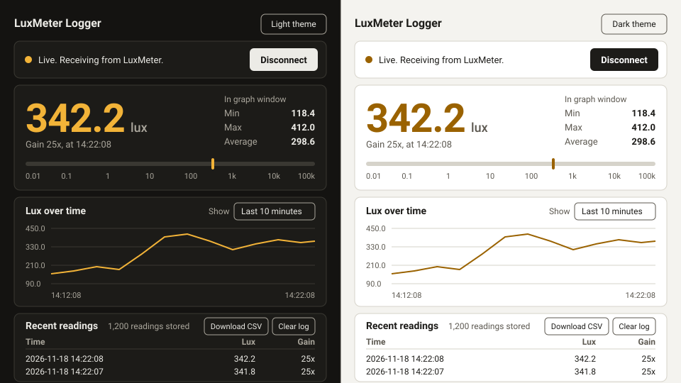
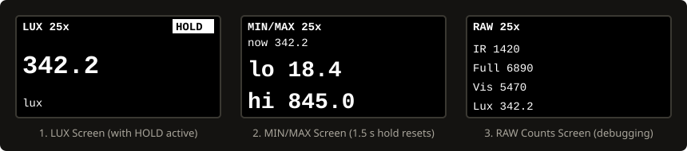
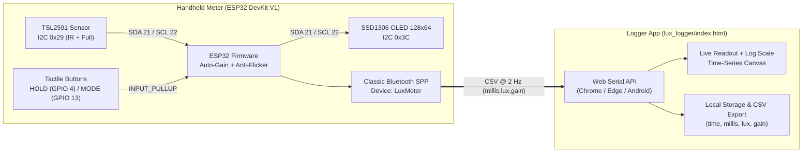
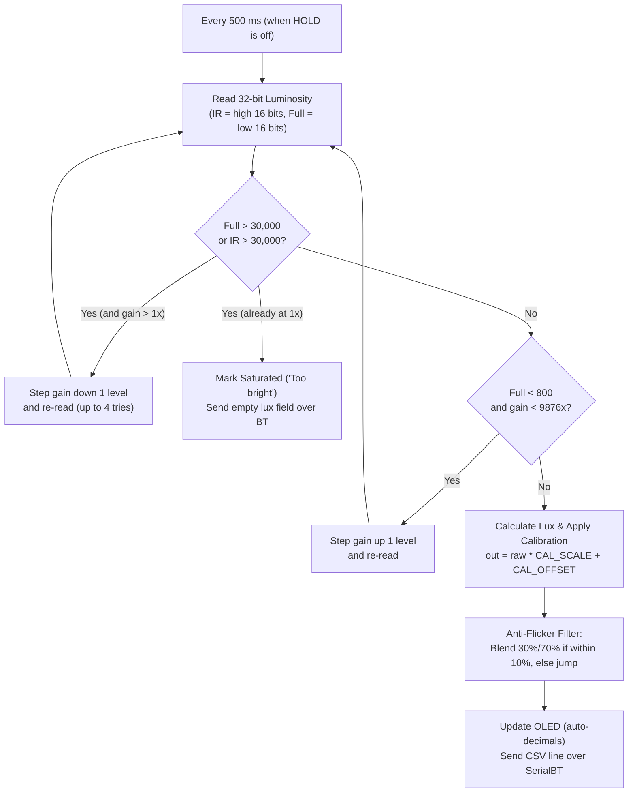

# DIY ESP32 Digital Lux Meter (TSL2591 + SSD1306 + Bluetooth Logger)


-f2b338?style=flat-square)


A handheld digital light meter built around a **classic ESP32**, an **Adafruit TSL2591** high-dynamic-range light sensor (IR + visible channels), and a **128x64 SSD1306 OLED** display. It features automatic 4-stage gain ranging (`1x` to `9876x`), tactile **HOLD** and **MODE** buttons, a 3D-printable enclosure, and real-time Bluetooth serial (`SPP`) telemetry to a zero-dependency web logger ([`lux_logger/index.html`](lux_logger/index.html)) for **Windows** and **Android**.

> [!NOTE]
> Verify your specific board pinout, OLED I2C address (`0x3C` vs `0x3D`), and calibration constants (`CAL_SCALE`, `CAL_OFFSET`) during bring-up using the staged test sketches in [`esp32_lux_meter/`](esp32_lux_meter/). Step-by-step instructions are in [`GUIDE.md`](GUIDE.md).

---

## Visual Overview

### Web Logger Interface (`lux_logger/index.html`)
The companion web app connects directly to the meter over Web Serial (Bluetooth RFCOMM/SPP), displaying a live instrument readout, a 7-decade logarithmic scale (`0.01` to `100k` lux), windowed `Min`/`Max`/`Average` statistics, a live time-series graph, and CSV export. Dark mode is the default so screen glow does not spill into low-lux sensor measurements, with a built-in Light theme toggle for outdoor or bright lab use.



### On-Device OLED Screens (`128x64` SSD1306)
Pressing the physical **MODE** button (`GPIO 13`) cycles through three on-device views, while **HOLD** (`GPIO 4`) freezes the current measurement:



---

## System Architecture



---

## Repository Structure

```text
lux_meter/
├── README.md                                              # Project overview, visuals, and quick start
├── GUIDE.md                                               # Step-by-step build, testing, and code guide
├── DIY ESP32 Lux Meter (TSL2591) Build Documentation.docx # Full hardware build and battery wiring doc
├── DIY_ESP32_Lux_Meter_Parts_List.xlsx                    # Bill of materials (BOM)
├── 3d_files/                                              # Printable enclosure files
│   ├── MAIN BODY.stl                                      # Main housing
│   ├── COVER.stl                                          # Snap/screw lid
│   └── lux_meter_basemodel.3mf                            # 3MF project file
├── docs/                                                  # Visual diagrams and UI previews
│   ├── logger-preview.svg                                 # Dark & light web logger preview
│   └── oled-screens.svg                                   # 128x64 OLED screen modes preview
├── esp32_lux_meter/                                       # Staged Arduino sketches
│   ├── README.md                                          # Firmware stage summary
│   ├── i2c_scanner/i2c_scanner.ino                        # Stage 1: Verify I2C addresses (0x29, 0x3C)
│   ├── basic_read/basic_read.ino                          # Stage 2: Fixed 25x gain sensor test
│   ├── auto_gain/auto_gain.ino                            # Stage 3: 4-step automatic gain ranging
│   ├── esp32_oled_test/esp32_oled_test.ino                # Stage 4: Standalone OLED & power check
│   ├── lux_meter_buttons/lux_meter_buttons.ino            # Stage 5: OLED + HOLD/MODE buttons
│   └── lux_meter_bt/lux_meter_bt.ino                      # Stage 6: Complete firmware with Bluetooth
└── lux_logger/
    └── index.html                                         # Single-file Web Serial logger & grapher
```

---

## Hardware Wiring

The TSL2591 sensor and SSD1306 OLED share the same two I2C pins (`GPIO 21` and `GPIO 22`). Both tactile buttons use the ESP32's internal pull-up resistors (`INPUT_PULLUP`), so no external resistors are needed.

| Component | Pin on Part | ESP32 Pin | Notes |
| --- | --- | --- | --- |
| **TSL2591 Sensor** | `VIN` / `GND` | `3V3` / `GND` | Do not connect `3Vo` or `INT` |
| **TSL2591 Sensor** | `SDA` / `SCL` | `GPIO 21` / `GPIO 22` | I2C address `0x29` (fixed) |
| **SSD1306 OLED** | `VCC` / `GND` | `3V3` / `GND` | 128x64 pixels |
| **SSD1306 OLED** | `SDA` / `SCL` | `GPIO 21` / `GPIO 22` | Shares I2C bus; address `0x3C` (or `0x3D`) |
| **HOLD Button** | Diagonal legs | `GPIO 4` and `GND` | Short press freezes/resumes measurement |
| **MODE Button** | Diagonal legs | `GPIO 13` and `GND` | Short press cycles views; 1.5 s hold resets min/max |

> [!IMPORTANT]
> Use an original **ESP32** board (such as **ESP32 DevKit V1**). Newer **ESP32-S3** and **ESP32-C3** boards only support Bluetooth Low Energy (BLE) and do not support the Classic Bluetooth Serial Port Profile (`BluetoothSerial.h`) used here.

---

## Auto-Gain & Measurement Pipeline

The TSL2591 spans four sensitivity tiers (`1x`, `25x`, `428x`, `9876x`) at a `100 ms` integration window (which covers an exact integer number of 50 Hz and 60 Hz AC mains half-cycles to reject indoor lighting flicker).



---

## Quick Start

### 1. Flash the ESP32 Firmware
1. Install **Arduino IDE** and add the **esp32** board package by *Espressif Systems* via Boards Manager.
2. Open **Tools > Manage Libraries** and install:
   - `Adafruit TSL2591 Library`
   - `Adafruit Unified Sensor`
   - `Adafruit SSD1306`
   - `Adafruit GFX Library`
3. Open [`esp32_lux_meter/lux_meter_bt/lux_meter_bt.ino`](esp32_lux_meter/lux_meter_bt/lux_meter_bt.ino) in Arduino IDE.
4. Select **Tools > Board > esp32 > ESP32 Dev Module**, pick your USB COM port, and click **Upload**.
5. Open the Serial Monitor at **115200 baud** to confirm readings are printing every 500 ms.

### 2. Connect the Web Logger
1. Pair **`LuxMeter`** in the Bluetooth settings of your Windows laptop or Android phone.
2. Open [`lux_logger/index.html`](lux_logger/index.html):
   - **Windows (Chrome or Edge):** Double-click `lux_logger/index.html`, click **Connect to meter**, and choose the **Outgoing** Bluetooth COM port.
   - **Android (Chrome 138+):** Serve `lux_logger/index.html` over `https://` (for example via GitHub Pages or Netlify Drop), tap **Connect to meter**, and pick **LuxMeter**.
3. Watch the live reading and time-series graph, and click **Download CSV** to export `time,millis,lux,gain`.

---

## Troubleshooting

| Symptom | Cause & Fix |
| --- | --- |
| **Logger says "Connected", but no data arrives** | Make sure **HOLD** is off on the meter. Check the OLED: if it says `TSL2591 not found`, the sensor wiring is loose (the meter also sends `error: TSL2591 not found` over Bluetooth). On Windows, reconnect and pick the **Outgoing** COM port (Bluetooth settings > More Bluetooth options > COM Ports). |
| **OLED stays blank** | Run [`i2c_scanner.ino`](esp32_lux_meter/i2c_scanner/i2c_scanner.ino) to check whether your screen uses `0x3C` or `0x3D`, then update `OLED_ADDR`. |
| **Laptop or phone cannot find `LuxMeter`** | Confirm your board is a classic ESP32 (not S3/C3). Remove any existing pairing and pair again. |
| **Upload hangs at `Connecting....`** | Hold down the physical `BOOT` button on the ESP32 for 2 seconds when uploading starts, and verify your USB cable carries data. |
| **Buttons do not respond** | Wire across two diagonal legs of the 4-pin tactile switch between the GPIO pin and `GND`. |

For a complete walkthrough of the hardware build stages, calibration math, and code internals, read **[`GUIDE.md`](GUIDE.md)**.
